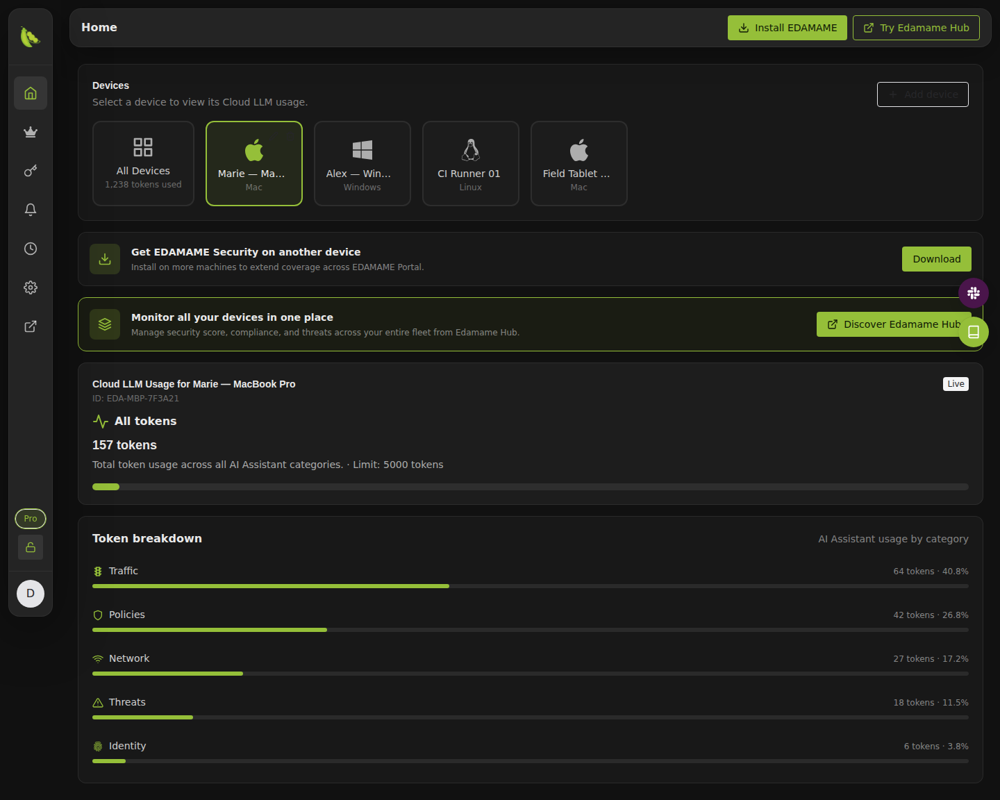
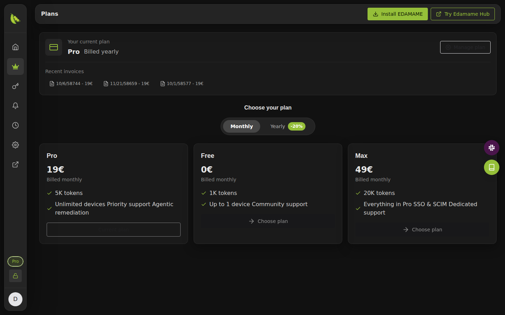
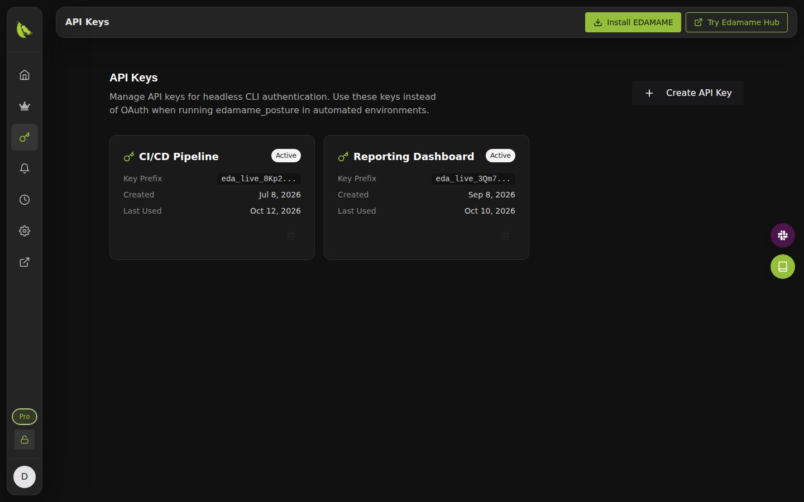
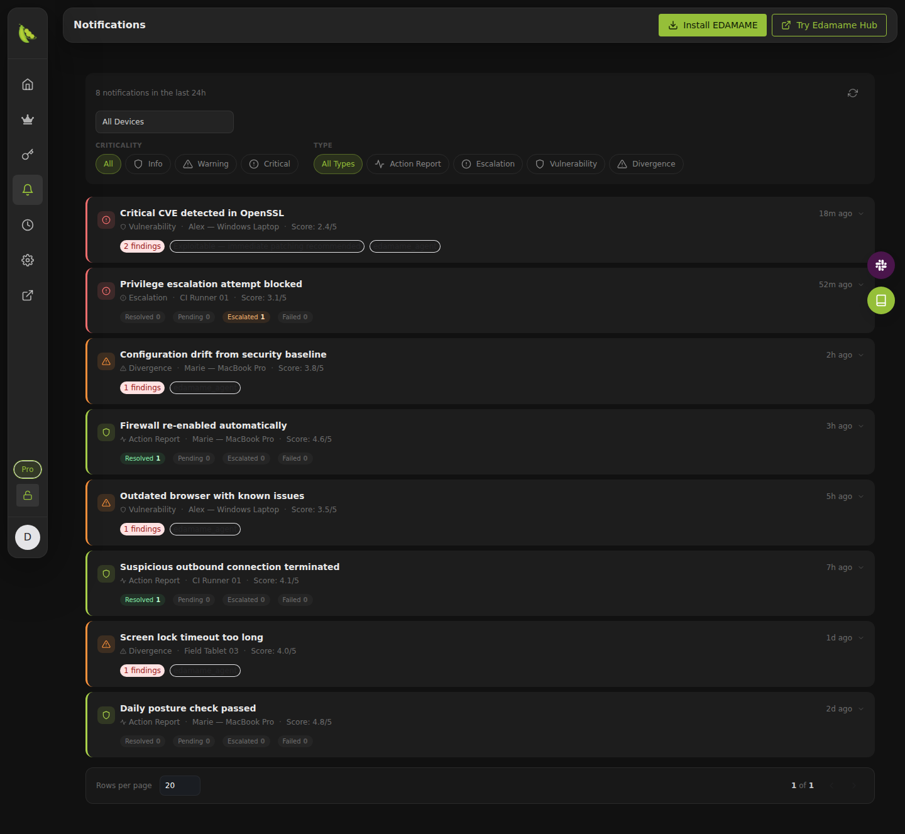

# EDAMAME Portal

> **EDAMAME** is the developer-first, agent-first runtime security layer for the SDLC. **EDAMAME Security** protects workstations and local coding sessions, **EDAMAME Posture** secures CI/CD runners, build hosts, and self-hosted agent hosts, **EDAMAME Hub** gives teams fleet visibility and proof, and **EDAMAME Portal** handles account access and managed LLM subscription.

## Overview

EDAMAME Portal is where you manage your EDAMAME account and your **Cloud LLM
(EDAMAME)** subscription: the managed AI service behind the AI Assistant of
EDAMAME Security and the AI review of its detections, with no model provider
account or API key of your own to set up.

From the Portal you choose a plan, follow how much of it each of your devices
uses, create API keys for EDAMAME Posture on CI/CD runners and servers, and
read the security notifications your devices send.

**Open the Portal:** [portal.edamame.tech](https://portal.edamame.tech) (free
plan available)

**Learn more:** [Feature wiki](https://github.com/edamametechnologies/edamame_portal/wiki)
| [Step-by-step guides](#step-by-step-guides)
| [AI Assistant user guide](https://github.com/edamametechnologies/edamame_security#ai-assistant--user-guide)

## Who it is for

- **Developers and individuals** who want EDAMAME Security's AI Assistant
  without managing an Anthropic, OpenAI or local model setup.
- **Teams running EDAMAME Posture** on CI/CD runners, build hosts and servers,
  which authenticate to the Cloud LLM with an API key instead of a browser
  sign-in.
- **Anyone with several devices** who wants one place to follow their AI usage
  and their devices' security notifications.

The Cloud LLM is optional. EDAMAME's discovery, scanning, benchmarks and
detections run locally without any model, and you can bring your own model
(Claude, OpenAI or a local Ollama) instead; see
[Deterministic by Design](https://github.com/edamametechnologies/edamame_security#deterministic-by-design-what-needs-an-llm-and-what-does-not).

## How it works

1. **Sign in from EDAMAME Security.** **Connect Portal**, under the app's
   Security radar or in **Config > AI**, opens the Portal in your browser;
   once you sign in, the app uses the Cloud LLM and turns protection on.
2. **Or use an API key.** For EDAMAME Posture and other headless
   environments, create a key in the Portal and set it in the
   `EDAMAME_LLM_API_KEY` environment variable, with the `edamame` provider.
3. **The Portal keeps track.** Each device's token usage counts toward your
   plan, and the notifications your devices send (the AI Assistant's action
   reports and escalations, vulnerability and divergence detections) are
   listed in the Portal.

What the Cloud LLM processes, and how, is described in the
[Portal AI service privacy policy](https://github.com/edamametechnologies/edamame_security/blob/main/privacy-LLM-EN.md)
([français](https://github.com/edamametechnologies/edamame_security/blob/main/privacy-LLM-FR.md)).

## Features

### Devices and usage

- Every device registered to your account, with its platform.
- Cloud LLM token usage for one device or all of them, against your plan's
  limit, broken down by what the AI Assistant worked on: traffic, policies,
  network, threats and identity.
- Register a device, or rename and remove one.

### Plans

- Token-based plans, from a free plan to paid plans with larger allowances
  and more devices.
- Monthly or yearly billing (yearly is cheaper), upgrade or downgrade at any
  time, and your recent invoices.

### API keys

- Named API keys for EDAMAME Posture, CI/CD pipelines and other automation,
  used instead of a browser sign-in.
- The full key is shown once, when you create it; afterwards the Portal shows
  its prefix, creation date and last use.
- Revoke a key as soon as it is no longer needed.

### Notifications

- The security notifications your devices sent over the last 24 hours: action
  reports, escalations, vulnerability and divergence detections.
- Filter by device, criticality (info, warning, critical) and type, and open a
  notification for its full message, the actions taken and their status.

### Account settings

- Change your EDAMAME account password.

## Screenshots

| | |
|---|---|
|  **Plans:** your current plan, invoices and the plans to choose from |  **API keys:** keys for EDAMAME Posture and automation |
|  **Notifications:** your devices' security notifications, filtered by device, criticality and type |  **Home:** Cloud LLM usage per device and per category |

These screenshots come from the production Portal on a demo account with
simulated devices and usage, and are refreshed automatically each time a new
version of the Portal is deployed. Every page is documented, with screenshots,
in the [feature wiki](https://github.com/edamametechnologies/edamame_portal/wiki).

## Getting started

1. **Install [EDAMAME Security](https://github.com/edamametechnologies/edamame_security)**
   on your workstation.
2. **Connect it to the Portal:** click **Connect Portal** under the Security
   radar (or in **Config > AI**) and sign in, or create your account, at
   [portal.edamame.tech](https://portal.edamame.tech).
3. **Choose a plan** in the Portal if the free plan is not enough.
4. **For CI/CD runners and servers**, create an API key in **API Keys**, store
   it as a secret, and expose it as the `EDAMAME_LLM_API_KEY` environment
   variable, with `--agentic-provider edamame` for
   [EDAMAME Posture](https://github.com/edamametechnologies/edamame_posture_cli)
   or `agentic_provider: edamame` for the
   [EDAMAME Posture GitHub Action](https://github.com/edamametechnologies/edamame_posture_action).

## Step-by-step guides

The wiki walks through the common tasks screen by screen:

- [Register a device](https://github.com/edamametechnologies/edamame_portal/wiki/workflow-register_device)
- [Create an API key](https://github.com/edamametechnologies/edamame_portal/wiki/workflow-create_api_key)
- [Choose a subscription plan](https://github.com/edamametechnologies/edamame_portal/wiki/workflow-choose_plan)
- [Filter device notifications](https://github.com/edamametechnologies/edamame_portal/wiki/workflow-filter_notifications)

## EDAMAME ecosystem

- **[EDAMAME Security](https://github.com/edamametechnologies/edamame_security):** desktop and mobile app for workstations and personal devices
- **[EDAMAME Posture](https://github.com/edamametechnologies/edamame_posture_cli):** CLI for CI/CD runners, build hosts and servers
- **[EDAMAME Posture GitHub Action](https://github.com/edamametechnologies/edamame_posture_action):** posture and network controls in GitHub workflows
- **[EDAMAME Hub](https://github.com/edamametechnologies/edamame_hub):** fleet visibility, compliance and conditional access for teams
- **[EDAMAME Helper](https://github.com/edamametechnologies/edamame_helper):** privileged helper used by EDAMAME Security
- **[Threat models](https://github.com/edamametechnologies/threatmodels):** the open security checks every endpoint evaluates

## About this repository

EDAMAME Portal is a hosted service and its source is closed. This repository
holds its public documentation: this README, the
[feature wiki](https://github.com/edamametechnologies/edamame_portal/wiki) and
the screenshots they use. Maintainers: see [CONTRIBUTING.md](CONTRIBUTING.md).

For questions, feedback and feature requests, contact EDAMAME Technologies
through [edamame.tech](https://www.edamame.tech).
